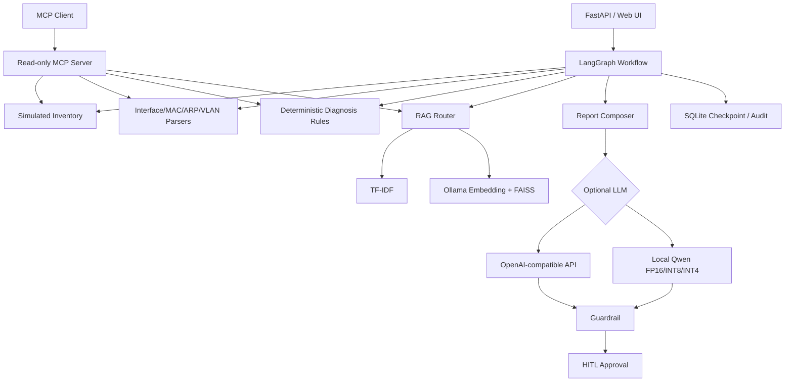

# Telecom NetOps AI Agent

面向接入网终端故障定位的**只读型 AI Agent 学习项目**。核心思路是将资源查询、网络证据解析、确定性规则诊断、RAG、LLM 辅助说明、Human-in-the-loop 和审计归档串成可恢复工作流。

> 公开仓库只包含完全模拟的数据与 Demo 知识，不连接运营商生产系统，不包含原始实习资料、内部系统信息、真实 IP/设备标识或生产配置。

## 核心能力

- **LangGraph 工作流**：资源查询 → 证据解析 → 规则诊断 → RAG → 报告 → 人工审批 → 归档，SQLite Checkpoint 支持恢复。
- **MCP 只读工具**：封装资源查询、Interface/MAC/ARP/VLAN 解析、诊断和知识检索。
- **确定性诊断优先**：关键网络事实由解析器和规则判断，LLM 不负责决定故障结论。
- **双后端 RAG**：TF-IDF 基线 + Ollama Embedding + FAISS 语义检索，可配置切换并支持回退。
- **LLM 后端可切换**：支持 OpenAI-compatible API 或本地 Hugging Face 模型。
- **本地量化实践**：Qwen2.5-0.5B-Instruct 支持 FP16 / INT8 / INT4(NF4) 对比。
- **安全兜底**：Guardrail、fallback、Human-in-the-loop、审计日志。

## 架构



## 技术栈

| 模块 | 技术 |
|---|---|
| Agent / Workflow | LangGraph, LangChain Core |
| Tool Protocol | MCP / FastMCP |
| API | FastAPI, Pydantic |
| RAG | TF-IDF, Ollama Embedding, FAISS |
| LLM | OpenAI-compatible API, Hugging Face Transformers |
| Quantization | bitsandbytes, FP16, INT8, INT4/NF4 |
| Storage | SQLite, CSV, JSONL |
| Engineering | Docker, pytest, Ruff, GitHub Actions |

## 快速开始

Python 3.10+：

```powershell
python -m venv .venv
.\.venv\Scripts\Activate.ps1
python -m pip install -r requirements.txt
Copy-Item .env.example .env
python -m scripts.seed_db
uvicorn app.main:app --reload --host 0.0.0.0 --port 8000
```

访问：

- Web Demo: `http://127.0.0.1:8000/`
- Swagger: `http://127.0.0.1:8000/docs`

## RAG

公开版本默认使用：

```env
RAG_BACKEND=tfidf
RAG_KNOWLEDGE_DIR=knowledge/demo
```

如需启用本地向量检索：

```powershell
ollama pull qwen3-embedding:0.6b
python -m scripts.build_vector_index
```

然后修改：

```env
RAG_BACKEND=vector
OLLAMA_BASE_URL=http://localhost:11434
OLLAMA_EMBED_MODEL=qwen3-embedding:0.6b
RAG_KNOWLEDGE_DIR=knowledge/demo
RAG_TOP_K=3
```

测试：

```powershell
python -m scripts.test_vector_retrieval
python -m scripts.evaluate_rag_retrieval
```

## 本地模型量化

可选安装：

```powershell
python -m pip install -r requirements-llm.txt
```

配置：

```env
LLM_ENABLED=true
LLM_BACKEND=local_hf
LOCAL_LLM_MODEL_ID=Qwen/Qwen2.5-0.5B-Instruct
LOCAL_LLM_QUANTIZATION=int4
LOCAL_LLM_MAX_NEW_TOKENS=96
```

性能比较：

```powershell
python -m scripts.benchmark_quantization --model Qwen/Qwen2.5-0.5B-Instruct --modes fp16 int8 int4 --repeats 5 --max-new-tokens 128
```

质量验证：

```powershell
python -m scripts.evaluate_quantization_quality_final --model Qwen/Qwen2.5-0.5B-Instruct --modes fp16 int4 --max-new-tokens 96 --seed 42
```

## 已完成的本地实验

### RAG：30 条模拟 Query

| Backend | Hit@1 | Hit@3 | Avg latency |
|---|---:|---:|---:|
| TF-IDF | 60.00% | 96.67% | 1.74 ms |
| Vector | 73.33% | 93.33% | 219.32 ms |

向量检索 Top-1 更好；TF-IDF 更快且在该小型知识库中的 Top-3 略高，因此保留双后端。

### 量化

GTX 1650 上 INT4/NF4 相较 FP16：

- 模型内存：942.29 MB → 430.42 MB
- 峰值 GPU 显存：964.68 MB → 462.46 MB
- 生成速度：16.383 → 13.708 tokens/s

详细聚合结果见 [`docs/EXPERIMENT_RESULTS.md`](docs/EXPERIMENT_RESULTS.md)。

## Demo 场景

公开资源均为模拟数据，例如：

| IP | 场景 |
|---|---|
| `10.60.10.21` | 接口 DOWN |
| `10.60.10.22` | 接口 UP 但无目标 MAC |
| `10.20.30.15` | VLAN 与资源记录不一致 |
| `10.20.30.16` | 接入侧正常、继续核查上层 |
| `10.20.30.17` | 端口登记不一致 |

```powershell
python -m scripts.run_demo --case vlan_mismatch
```

## GitHub 公开边界

不会提交：

- `.env` / API Key
- `runtime/`
- `.venv/`
- `knowledge/sanitized/`
- `knowledge/source_private/`
- PDF/PPT/Word/RAR/7z 等原始资料
- FAISS 本地索引、SQLite 状态库和原始模型输出

公开知识只位于 `knowledge/demo/`。

## 测试

```powershell
python -m pip install -r requirements-dev.txt
ruff check app scripts tests
pytest -q
```

## 真实性说明

该项目是个人学习与求职作品：

- 不接入真实生产网管或交换机；
- 不自动执行生产网络配置；
- 不使用真实客户/工单数据；
- 只使用模拟数据和公开 Demo 知识；
- 简历中的实验数字仅引用本人实际跑出的本地结果。

详见 [`docs/PROJECT_BOUNDARY.md`](docs/PROJECT_BOUNDARY.md)。

## License

MIT
