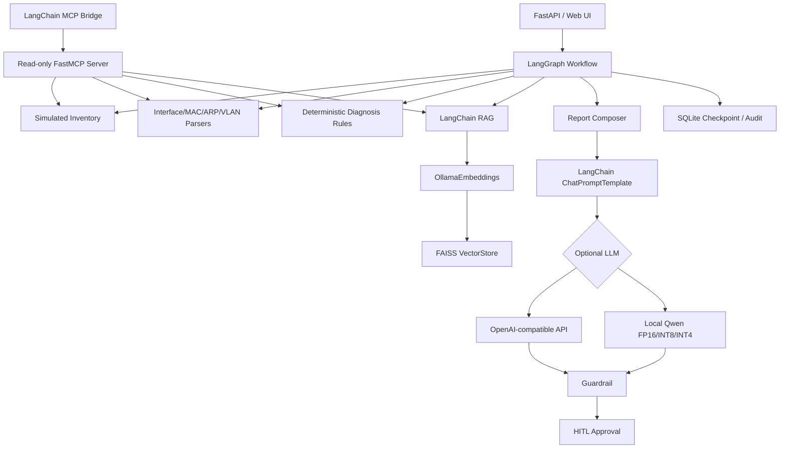

# Telecom NetOps AI Agent

面向接入网终端故障排查场景搭建的只读型 AI Agent。项目使用模拟资源和网络数据，将资源查询、网络状态解析、确定性故障判断、RAG 知识检索和诊断结果整理串成可恢复工作流。

> 公开仓库仅包含模拟数据与 Demo 知识，不连接运营商生产系统，不包含真实 IP、设备标识、账号密钥或内部资料。

## 主要功能

- **LangGraph 工作流**：编排资源查询、证据解析、规则诊断、RAG、报告生成、人工确认和归档，SQLite Checkpoint 支持恢复。
- **LangChain 应用组件**：使用 `ChatPromptTemplate` 组织受限 LLM 提示，使用 LangChain FAISS VectorStore 与 OllamaEmbeddings 完成本地 RAG。
- **MCP 只读工具**：通过 FastMCP 封装资源查询、Interface/MAC/ARP/VLAN 解析、规则诊断和知识检索，并提供 `langchain-mcp-adapters` 兼容桥接。
- **确定性诊断优先**：关键网络事实由解析器和规则引擎判断，LLM 只负责辅助说明，不直接修改诊断结论。
- **本地轻量推理**：支持 Qwen2.5-0.5B-Instruct 的 FP16 / INT8 / INT4(NF4) 推理实践。
- **安全兜底**：RAG fail-open、LLM Guardrail、Human-in-the-loop、审计日志和只读边界。

## 架构



## 技术栈

| 模块 | 技术 |
|---|---|
| Agent / Workflow | LangGraph, LangChain |
| Tool Protocol | MCP, FastMCP, langchain-mcp-adapters |
| API | FastAPI, Pydantic |
| RAG | OllamaEmbeddings, FAISS |
| LLM | OpenAI-compatible API, Hugging Face Transformers |
| Quantization | bitsandbytes, FP16, INT8, INT4/NF4 |
| Storage | SQLite, CSV, JSONL |
| Engineering | Docker, pytest, Ruff, GitHub Actions |

## 快速开始

Python 3.10+：

```powershell
python -m venv .venv
.\.venv\Scripts\Activate.ps1
python -m pip install -r requirements.txt
Copy-Item .env.example .env
python -m scripts.seed_db
```

准备本地 RAG：

```powershell
ollama pull qwen3-embedding:0.6b
python -m scripts.build_vector_index
```

启动：

```powershell
uvicorn app.main:app --reload --host 0.0.0.0 --port 8000
```

- Web Demo: `http://127.0.0.1:8000/`
- Swagger: `http://127.0.0.1:8000/docs`

如果暂时不运行 Ollama，可在 `.env` 中设置 `RAG_ENABLED=false`；确定性诊断流程仍可正常运行。

## RAG

当前版本仅保留 LangChain 向量检索链路：

```text
knowledge/demo/*.md
        ↓
LangChain Document
        ↓
OllamaEmbeddings
        ↓
FAISS
        ↓
Retriever
        ↓
LangGraph retrieve node
```

配置示例：

```env
RAG_ENABLED=true
RAG_KNOWLEDGE_DIR=knowledge/demo
RAG_TOP_K=3
RAG_FAIL_OPEN=true
OLLAMA_BASE_URL=http://localhost:11434
OLLAMA_EMBED_MODEL=qwen3-embedding:0.6b
```

重新构建索引：

```powershell
python -m scripts.build_vector_index
python -m scripts.test_vector_retrieval
```

## MCP / LangChain 工具桥接

启动独立 MCP Server：

```powershell
python -m app.mcp_server
```

验证 MCP 工具能够被转换为 LangChain Tools：

```powershell
python -m scripts.test_langchain_mcp_bridge
```

主诊断工作流仍直接调用本地确定性解析器和规则，不让 LLM 自主选择写操作或决定故障结论；MCP Bridge 用于展示标准工具协议和 LangChain/LangGraph 生态互操作。

## 本地模型量化

可选安装：

```powershell
python -m pip install -r requirements-llm.txt
```

配置：

```env
LLM_ENABLED=true
LLM_BACKEND=local_hf
LOCAL_LLM_MODEL_ID=Qwen/Qwen2.5-0.5B-Instruct
LOCAL_LLM_QUANTIZATION=int4
LOCAL_LLM_MAX_NEW_TOKENS=96
```

## Demo

项目内置接口 DOWN、无目标 MAC、VLAN 不一致、接入侧正常需继续核查上层、端口登记不一致等模拟场景。

```powershell
python -m scripts.run_demo --case vlan_mismatch
```

## 项目边界

该仓库用于学习和展示网络运维场景下的 Agent 开发流程。资源数据、交换机状态和知识库均为模拟内容，不连接真实生产网络，也不会执行网络配置修改操作。

详细说明见 `docs/`。

## License

MIT
